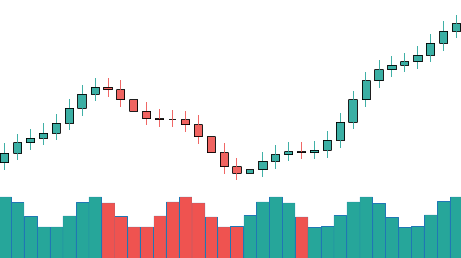

# Генератор свечных графиков

Python-утилита для подготовки изображений к разметке и экспериментам с компьютерным зрением. На входе CSV со временем, ценами OHLC и объёмом. На выходе набор PNG, по одному на каждое перекрывающееся окно.



## Запуск

Для запуска нужны Python, pandas, mplfinance, Matplotlib, Pillow и tqdm. Установите пакеты в отдельное виртуальное окружение.

```bash
python -m pip install pandas mplfinance matplotlib Pillow tqdm
python candle_generator.py demo.csv --output demo-images --window 36 --step 16
```

В собственной CSV-выгрузке используйте столбцы `Open time`, `Open`, `High`, `Low`, `Close` и `Volume`. Даты сортируются по `Open time`. Параметры `--window`, `--step`, `--dpi` и `--batch` управляют размером окна, шагом, разрешением и размером пакета. Используйте `--help` для полного списка.

## Проверенный результат

Демонстрационный файл содержит 68 синтетических свечей. При размере окна 36 и шаге 16 скрипт сгенерировал три PNG. Проверка относится к подготовке изображений. Результаты обучения или качество прогноза в проекте не измерялись.

Авдей Голубков · [профиль GitHub](https://github.com/avdey105)
